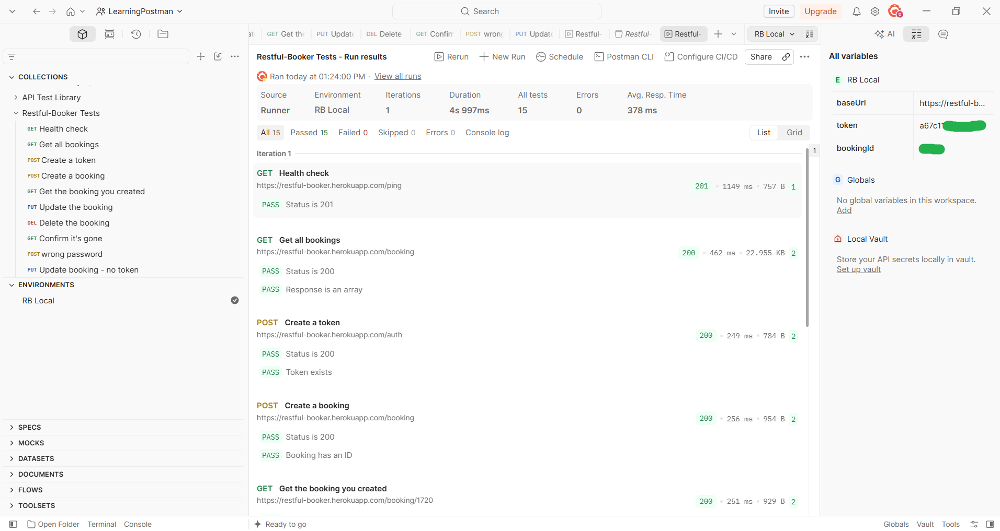
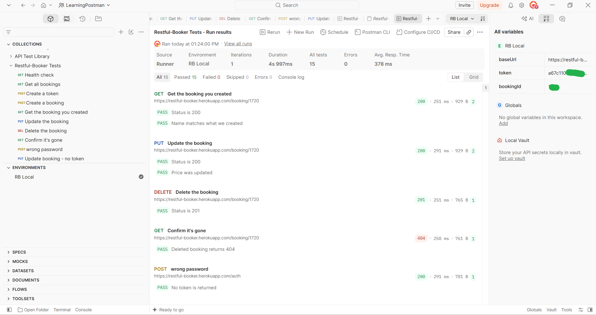
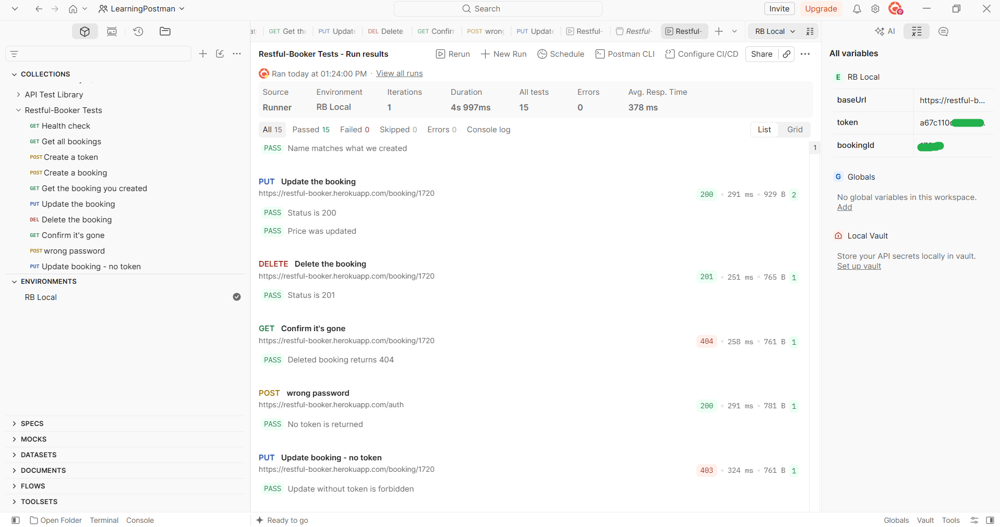

# Restful-Booker API Tests (Postman)

Postman collection testing the Restful-Booker practice API
(https://restful-booker.herokuapp.com).

## What I tested
- Full booking lifecycle: create, read, update, delete
- Authentication (token creation and reuse)
- Negative cases: wrong password, update without a token

## How to use
1. Import both JSON files into Postman.
2. Select the "RB Local" environment.
3. Right-click the collection, choose Run collection, then Run.

## Requests
1. Health check
2. Get all bookings
3. Create a token
4. Create a booking
5. Get the booking you created
6. Update the booking
7. Delete the booking
8. Confirm it's gone
9. Wrong password (negative)
10. Update booking - no token (negative)

## Notes
Token and booking ID are saved automatically by test scripts at run time.
